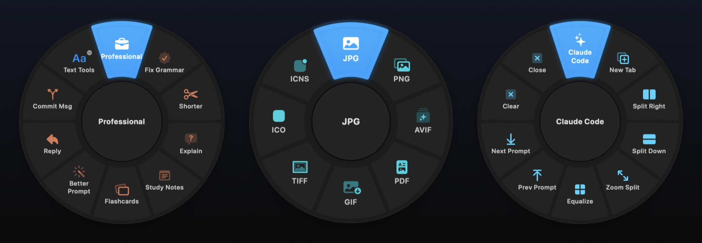
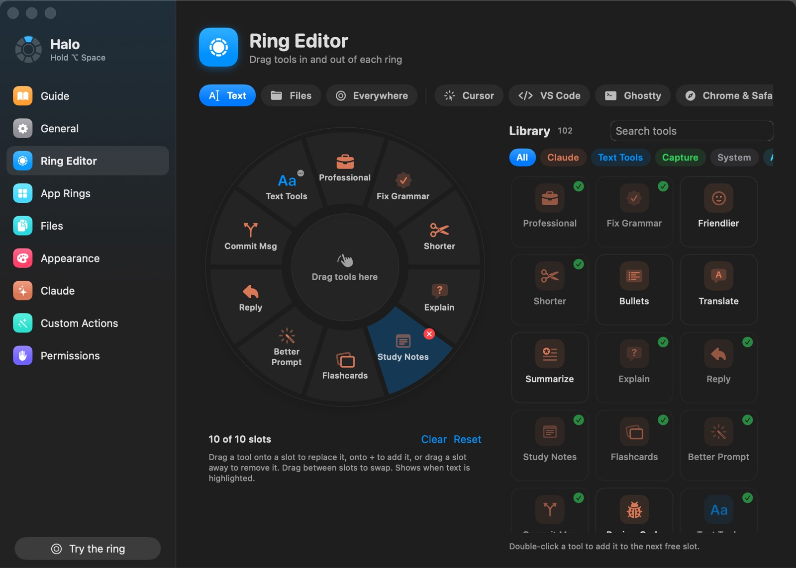

# Halo - A Radial Action Ring For Your Mac

Hold **⌥ Space** anywhere, flick toward an action and let go. Halo opens a ring of
actions at your cursor that fits whatever you're pointing at: Claude rewrites for
highlighted text, Filee-style conversions for files in Finder, and a ring of shortcuts
for the app you're in. Claude actions run on your Claude subscription, so there's no
API bill.



## At a Glance

- **Stack:** Swift, SwiftUI, AppKit, Vision, PDFKit, AVFoundation, the `claude` CLI (no external libraries)
- **Platforms:** macOS 14+, Apple silicon and Intel
- **State:** Complete

## Features

- **A ring that follows what you point at.** Highlighted text gets the Text ring, Finder
  files get the Files ring, apps get their own ring, and everywhere else gets Everywhere
- **Claude on your plan.** Professional, Fix Grammar, Shorter, Explain, Reply, Translate
  and your own prompts, through Claude Code's login instead of a paid API key
- **Study tools.** Study Notes (Markdown, ready for Obsidian) and Flashcards (imports
  straight into Anki) from highlighted text or lecture PDFs
- **Developer tools.** Commit messages from a diff, code review, Copy for AI (files as
  fenced Markdown), Open in Cursor or VS Code, JSON, Base64 and URL tools
- **Filee-style conversions.** Convert ▸ offers only the formats a file can become:
  images, PDFs, Word/RTF/HTML/ODT, audio and video, all with macOS's built-in converters.
  Plus compress, resize, rotate, background removal, OCR, merge and split
- **App rings.** Cursor, VS Code, Ghostty (with a slot that starts Claude Code), Chrome &
  Safari with GitHub links, Notion, Obsidian and Zoom, or any app you add
- **Drag-and-drop Ring Editor.** Drag tools from a library of 100+ onto any ring, swap
  slots, drag them off to remove
- **Custom actions.** Claude prompts, recorded keyboard shortcuts, links, macOS Shortcuts,
  shell commands that get the selection, and apps
- **Labels always fit.** The ring sizes itself so every name has room
- **In-app Guide** with a setup checklist that ticks itself off



## Project Structure

```
.
├── Sources/
│   ├── HaloKit/                 # Everything testable, no UI
│   │   ├── ActionCatalog.swift  # Claude, text and Everywhere actions, default rings, sub-rings
│   │   ├── FileActions.swift    # Files ring: which actions and formats fit a selection
│   │   ├── FileOps.swift        # Image, PDF, video and archive operations
│   │   ├── Converters.swift     # Documents via textutil, audio via afconvert, PDF output
│   │   ├── FileAI.swift         # Claude reads files: summaries, notes, flashcards, renames
│   │   ├── ClaudeClient.swift   # claude CLI (subscription) or Messages API
│   │   ├── Rewrite.swift        # Prompts for each text action
│   │   ├── TextTools.swift      # Case, sort, JSON, Base64, URL and other local tools
│   │   ├── ProfilePresets.swift # App rings and their shortcuts
│   │   ├── Settings.swift       # Settings model and storage
│   │   └── RingGeometry.swift   # Slice hit-testing and ring sizing
│   └── Halo/                    # The app
│       ├── RingController.swift # Opens the ring, tracks the pointer, sub-rings
│       ├── RingView.swift       # The ring itself
│       ├── ActionRunner.swift   # Runs a chosen action and reports in the HUD
│       ├── ContextReader.swift  # Reads the selection and pastes results back
│       └── Settings/            # Guide, Ring Editor, App Rings and the other panes
├── Tests/HaloKitTests/          # Conversions, prompts, rings, settings and more
└── scripts/
    ├── build-app.sh             # Builds Halo.app, --install puts it in /Applications
    ├── make-icon.swift          # Draws the app icon
    └── test.sh                  # Runs the tests, with or without full Xcode
```

## Install

1. Download **Halo.zip** from the [latest release](https://github.com/nakulpatel0306/halo/releases/latest),
   unzip it and drag **Halo.app** into Applications.
2. Open it. Halo isn't notarized, so macOS will say it can't verify the developer: go to
   System Settings > Privacy & Security, scroll down and click **Open Anyway**.
3. Follow the Guide that opens. It checks off each step as you go:
   - Allow Halo in Privacy & Security > Accessibility
   - Install [Claude Code](https://claude.com/claude-code) and sign in once by running `claude`
     (or paste an Anthropic API key in Settings > Claude instead)
   - Click OK when macOS asks if Halo can control Finder

## Running Locally

Needs the Xcode Command Line Tools (`xcode-select --install`). For Claude actions, install
[Claude Code](https://claude.com/claude-code) and sign in once by running `claude`.

1. Clone the repo:
   ```bash
   git clone https://github.com/nakulpatel0306/halo.git
   cd halo
   ```
2. Build and install:
   ```bash
   ./scripts/build-app.sh --install
   ```
   This builds `Halo.app`, copies it to `/Applications` and opens it.
3. Allow Halo in System Settings > Privacy & Security > Accessibility. It reads highlighted
   text, pastes results and presses app shortcuts.
4. The first time you open the ring on files in Finder, click OK when macOS asks if Halo can
   control Finder.

Each rebuild changes the app's ad-hoc signature, so turn Halo off and on again in
Accessibility after reinstalling.

Run the tests with `./scripts/test.sh`.

## How to Use

- Hold ⌥ Space, move toward an action and let go. Let go in the middle to cancel
- Tap ⌥ Space to keep the ring open, then click. Esc closes
- Slices with a ⋯ badge (Convert, Text Tools) open a sub-ring; click the middle to go back
- Rewrites replace your selection. Explain, Study Notes, Flashcards, Commit Msg and Review
  Code are copied to the clipboard
- File results are saved as new files next to the original, never over it
- Everything else, including setup, tips and fixes, is in the menu bar icon > How to Use Halo

## Contributing

Ideas and pull requests are welcome. See [CONTRIBUTING.md](CONTRIBUTING.md) for how to add
a Claude action, an app ring or a file format.
